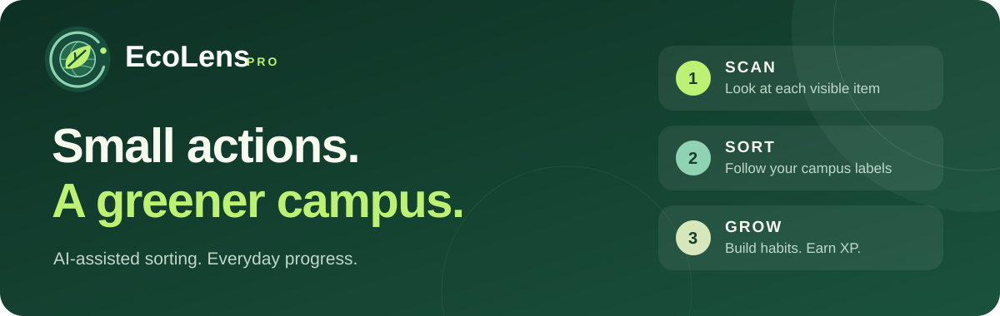

<p align="center">
  
</p>

<h1 align="center">EcoLens Pro</h1>
<p align="center"><strong>Scan an item. Find its next step. Build a greener campus.</strong></p>
<p align="center">
  <a href="https://ecolens-live.web.app/"><strong>🌿 Open EcoLens</strong></a>
  &nbsp; · &nbsp;
  <a href="https://ecolens-live-naac.web.app/"><strong>📊 Public NAAC reports</strong></a>
  &nbsp; · &nbsp;
  <a href="docs/TECHNICAL.md"><strong>🛠 Developer guide</strong></a>
</p>
<p align="center">Offline + online AI &nbsp; • &nbsp; English · বাংলা · हिन्दी &nbsp; • &nbsp; Phone + laptop</p>

---

## Meet EcoLens

EcoLens helps students and campus communities identify waste, separate mixed items, and follow disposal guidance. Small actions become a personal journey with XP, levels, streaks and upcycling quests.

Your name and institution appear at the top of the home page. Choose from **34 schools, colleges and universities** in Kolkata and nearby areas, or add your own institution. These are community options, not claimed partnerships.

## What you can do

<table>
  <tr>
    <td width="50%" valign="top"><h3>📷 Scan &amp; sort</h3><p>Use a camera or upload a photo. Check individual items in mixed waste, confirm uncertain materials, and follow your campus bin labels.</p></td>
    <td width="50%" valign="top"><h3>🌱 Learn &amp; level up</h3><p>Earn XP through completed quests, build daily streaks, unlock ten levels, and try four upcycling tutorials.</p></td>
  </tr>
  <tr>
    <td width="50%" valign="top"><h3>🌍 Make it yours</h3><p>Switch between English, Bengali and Hindi, listen to guidance, and choose a light, dark or device-matching theme.</p></td>
    <td width="50%" valign="top"><h3>📊 Follow your impact</h3><p>See personal contributions, download reports, and optionally share anonymous institution totals on the public NAAC page.</p></td>
  </tr>
</table>

## Try it in a minute

1. **[Open EcoLens](https://ecolens-live.web.app/)** on your phone or laptop.
2. **Enter your name and institution.** Your profile and progress are saved in that browser.
3. **Scan or upload a photo.** Choose **Mixed waste** when several items are together.
4. **Check the result.** Confirm uncertain materials, keep reusable items in use, and follow the collection labels at your campus.

### Choose your scanning mode

| Mode | How it works | What to do first |
| --- | --- | --- |
| **◉ Offline** | AI checks the image on your device. | While connected, select **Prepare offline access** and wait for the approximately **45 MB** download to finish. |
| **✧ Online** | Google Gemini can provide an additional image check. Local scanning remains available. | Open **Settings**, read the Google photo notice, allow photo checks and save. Then select **Online**. |

An **Online** badge on the result confirms that the scan used cloud AI. The cloud attempt is limited to about **12 seconds**; unavailable connections or quotas fall back to the local scanner when available. You can also select **Use this result** to accept a completed local result.

Camera access and offline preparation need **HTTPS or localhost**. Spoken guidance depends on voices installed on the device; written guidance is available in all three languages.

## Your data, explained simply

| Information | Where it goes |
| --- | --- |
| **Name, institution, XP and personal history** | Stay in your browser. Export a backup to move progress to another device. |
| **Offline scan photos** | Stay on your device. |
| **Online scan photos** | Go to Google only after you allow photo checks. Google’s free service may use submitted photos to improve its products. |
| **Public NAAC report** | Shows opted-in, anonymous totals for catalog institutions. Student names, photos and named contribution rows are never published there. |

Google photo permission and public NAAC sharing are **separate settings**. Both can be turned off; restoring a backup requires opting in again. Custom institution records stay private.

**Read results with care:** AI suggestions can be wrong, and confidence is a model score—not a measured accuracy rate. Impact figures are self-reported estimates, not a certified NAAC audit or verified disposal record. Your campus collection rules take priority.

## Built with

| Part | Technologies |
| --- | --- |
| **Interface** | HTML5, CSS3, vanilla JavaScript ES modules and SVG branding |
| **On-device AI** | Custom waste-detection model, ONNX Runtime Web, TensorFlow.js and COCO-SSD |
| **Cloud AI** | Google Gemini 3.5 Flash-Lite through Firebase AI Logic |
| **Hosting & shared reports** | Firebase Hosting, Realtime Database and anonymous Authentication |
| **Cloud request protection** | Firebase App Check with reCAPTCHA Enterprise |
| **Browser features** | Camera API, Canvas, Web Speech API, Service Workers, Cache API and localStorage |
| **Development** | VS Code, Git/GitHub, Node.js and Firebase CLI; Python utilities were used for model conversion |

The hosted project uses the **free Firebase Spark plan with billing disabled**. Free quotas apply, and cloud availability can change. There is no automatic paid fallback. See [Firebase AI Logic pricing](https://firebase.google.com/docs/ai-logic/pricing).

## Run it locally

You need **Node.js 20 or newer**. Open the project in VS Code, then run:

```sh
git clone https://github.com/k-m-rahaman/Ecolens.git
cd Ecolens
npm start
```

Open **http://127.0.0.1:8787**. No package installation is needed. Local scanning works without an AI key; the hosted Firebase cloud connection is restricted to its configured website domains.

<details>
<summary><strong>More setup options and developer commands</strong></summary>

```sh
npm start -- --lan    # Photo-upload preview on the same Wi-Fi
npm test             # Run existing automated checks
npm run build:static # Prepare the reviewed public website files
```

The HTTP phone preview supports uploads; use HTTPS for phone camera access and reliable offline preparation. VS Code **Go Live** also supports the static interface. Opening `index.html` directly as a file does not.

The [developer guide](docs/TECHNICAL.md) keeps the complete instructions for the optional Node.js/cloud gateway, deployment, database rules, report calculations, backups, model details and release caching. The repository also includes an alternative Cloudflare Worker gateway.

Never put a private AI key or administrator credential in frontend code or Git commits. Firebase web configuration and the App Check site key are public identifiers.

</details>

## The people behind EcoLens

| Contribution | Name |
| --- | --- |
| Project lead | **Kazi Mustafijur Rahaman** |
| Original UI/UX design | **Anisha Aktar** |
| Original systems & flowchart design | **Koyel Basu** |

See [third-party notices](THIRD_PARTY_NOTICES.md) for runtime and model sources. Editable logo files are in [`assets/`](assets/ecolens-brand-guide.md).

---

<p align="center"><strong>Small actions. A greener campus. 🌿</strong></p>
